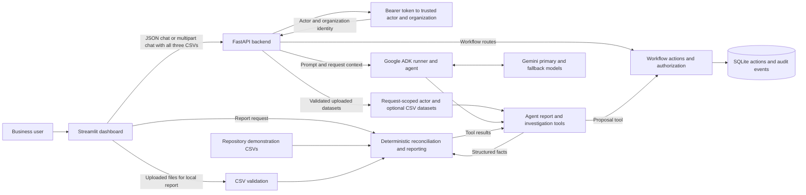

# AI Business Operations Agent

> Turn business data into actionable operational insights—with verified facts and human-controlled actions.

The **AI Business Operations Agent** is a Python-based AI-assisted business operations and reconciliation prototype developed by **Slimes.Hustlers AI Solutions**. It combines deterministic processing of order, invoice, and inventory CSVs with a Google ADK agent that can explain reports, investigate individual records, and propose controlled workflow actions.

The calculations and exception classifications are produced by Python business rules. Gemini generates the conversational response; it is not the system of record and should not replace review of source records or human decisions. This repository demonstrates an evolving engineering project and portfolio example. It does not establish a production deployment or commercial customer use.

## Contents

- [Key capabilities](#key-capabilities)
- [Architecture](#architecture)
- [Technology stack](#technology-stack)
- [Repository structure](#repository-structure)
- [Prerequisites](#prerequisites)
- [Installation on Windows PowerShell](#installation-on-windows-powershell)
- [Configuration and security](#configuration-and-security)
- [Running the application](#running-the-application)
- [API usage](#api-usage)
- [Business data formats](#business-data-formats)
- [Workflow governance and safety](#workflow-governance-and-safety)
- [Running tests](#running-tests)
- [Limitations and roadmap](#limitations-and-roadmap)
- [Troubleshooting](#troubleshooting)
- [Contributing, security, and license](#contributing-security-and-license)
- [Project and attribution](#project-and-attribution)

## Key capabilities

- **Order and invoice reconciliation:** matches records by `order_id`, calculates expected order amounts (`quantity × unit_price`), and reports missing invoices and amount mismatches.
- **Orphan invoice detection:** identifies invoices that reference an order ID not present in the supplied orders.
- **Inventory monitoring:** flags stock at or below the configured reorder level.
- **Structured operations reports:** returns counts and exception lists with deterministic priorities and recommended review actions.
- **Record investigations:** agent tools retrieve verified details for a specified order, invoice, or inventory SKU.
- **CSV upload and validation:** accepts a complete orders/invoices/inventory set for reporting and request-scoped agent analysis.
- **AI-assisted analysis:** the Google ADK agent uses report and investigation tools and is instructed to ground factual claims in their results.
- **Authenticated API:** maps bearer tokens configured by the server operator to user IDs, organization IDs, and roles. Workflow records and reads are organization-scoped.
- **Governed workflow proposals:** authorized users can create replenishment proposals; a different verified actor must approve, and only an approved action can be marked executed.
- **Audit events:** successful proposal, approval, and simulated execution transitions record an actor and timestamp in SQLite.
- **Streamlit dashboard:** displays a report from repository demonstration CSVs or all three uploaded files, and provides a chat interface to the API.

**Deterministic logic and AI are separate responsibilities.** Python calculates reconciliation and inventory results. The model selects tools and presents natural-language explanations or suggestions. Model output is probabilistic; instructions to use verified results do not guarantee that every generated answer is correct.

The API's `EXECUTED` status is simulated. It does not submit a supplier purchase or change inventory in an external system.

## Architecture



For dashboard report rendering, the Streamlit process validates uploaded files and calls the report builder locally. Dashboard chat is a separate HTTP request to FastAPI; when uploads are present, the dashboard sends all three CSVs to the chat endpoint. In that request, the API validates the files and makes the data available to agent tools through request-scoped context.

The agent does not connect directly to SQLite. Workflow routes and the agent's proposal tool call the workflow module, which applies authorization and persists actions/events. No external accounting, ERP, inventory, payment, or supplier service is connected.

## Technology stack

The pinned package versions are maintained in [`requirements.txt`](requirements.txt). The project uses:

| Area | Technology |
|---|---|
| Language | Python |
| API | FastAPI, Uvicorn, Pydantic |
| Dashboard | Streamlit |
| Tabular data | Pandas |
| Agent framework and model client | Google Agent Development Kit (ADK), Google GenAI |
| Generative models | Gemini, with configured primary and fallback model names |
| Workflow persistence | SQLite |
| Tests | Pytest |

The repository does not declare a formal `requires-python` field or supported-version matrix. Python 3.11 or newer is implied by use of `enum.StrEnum`.

## Repository structure

```text
.
├── dashboard.py
├── data/                         # Default local SQLite workflow database directory
├── docs/
│   └── system-audit/             # Architecture, API, workflow, testing, and audit notes
├── src/
│   ├── agents/
│   │   ├── business_data_context.py
│   │   ├── business_operations_agent.py
│   │   ├── model_fallback.py
│   │   └── request_context.py
│   ├── api/
│   │   └── main.py
│   ├── data/
│   │   ├── invoices.csv
│   │   ├── inventory.csv
│   │   └── orders.csv
│   ├── reconciliation/
│   │   ├── business_rules.py
│   │   ├── engine.py
│   │   ├── report.py
│   │   └── uploads.py
│   ├── schemas/
│   └── workflows/
│       ├── actions.py
│       └── authorization.py
├── tests/
│   ├── conftest.py
│   ├── test_api.py
│   ├── test_business_rules.py
│   ├── test_model_fallback.py
│   ├── test_reconciliation.py
│   ├── test_uploaded_agent_tools.py
│   ├── test_uploads.py
│   └── test_workflows.py
├── pyproject.toml                # Pytest configuration
└── requirements.txt              # Pinned dependencies
```

Local `.env` files, virtual environments, caches, and SQLite database files are excluded by [`.gitignore`](.gitignore).

## Prerequisites

- **Python 3.11 or newer.** `enum.StrEnum` in the authorization module requires Python 3.11+. The repository does not declare an upper bound or a tested-version matrix.
- **Git** to clone the repository.
- **Gemini provider credentials** for live agent chat. The report-only dashboard and deterministic tests do not require a live model call.

Check installed versions in PowerShell:

```powershell
python --version
git --version
```

If Git is not installed, install Git for Windows from [git-scm.com](https://git-scm.com/download/win). Install Python 3.11+ from [python.org](https://www.python.org/downloads/windows/) if it is not available.

## Installation on Windows PowerShell

Clone the project and enter its directory:

```powershell
git clone https://github.com/Hlomohangcue/AI-BUSINESS-OPERATIONS-AGENT.git
Set-Location .\AI-BUSINESS-OPERATIONS-AGENT
```

Create and activate a virtual environment, then install the pinned dependencies:

```powershell
py -3.11 -m venv .venv
.\.venv\Scripts\Activate.ps1
python -m pip install --upgrade pip
python -m pip install -r requirements.txt
```

If PowerShell blocks activation, either permit activation for the current PowerShell process (`Set-ExecutionPolicy -Scope Process -ExecutionPolicy Bypass`) and run `.\.venv\Scripts\Activate.ps1` again, or call the virtual environment's executables directly, for example:

```powershell
.\.venv\Scripts\python.exe -m pip install -r requirements.txt
```

No `.env.example` is currently provided. The application reads its settings from process environment variables; the repository code does not automatically load a `.env` file. Set secrets in the relevant process environment or use an appropriate secret manager. Never commit `.env` files, API keys, bearer tokens, or business data.

## Configuration and security

### Environment variables

| Variable | Required for | Purpose |
|---|---|---|
| `BUSINESS_OPERATIONS_API_TOKENS_JSON` | Authenticated API routes | Server-side JSON map from bearer-token values to `user_id`, `organization_id`, and `role`. Missing or invalid configuration causes protected routes to return `503`. |
| `BUSINESS_OPERATIONS_API_TOKEN` | Dashboard chat | Bearer token sent by the dashboard. Chat submission is disabled when it is unset. Its value must match a key in the API token registry. |
| `BUSINESS_OPERATIONS_API_URL` | Optional dashboard setting | API base URL; defaults to `http://127.0.0.1:8000`. |
| `WORKFLOW_DB_PATH` | Optional workflow setting | SQLite path override. By default, the application uses `<repository>\data\workflow_actions.db`. |
| `GOOGLE_API_KEY` or `GEMINI_API_KEY` | Gemini API-key authentication | Google GenAI API key configuration recognized by the pinned Google GenAI client. If both are set, that client gives `GOOGLE_API_KEY` precedence. |
| `GOOGLE_GENAI_USE_VERTEXAI` | Optional Vertex AI configuration | Selects Vertex AI mode in the Google GenAI client. Vertex AI also uses `GOOGLE_CLOUD_PROJECT` and `GOOGLE_CLOUD_LOCATION`; configure the required Google credentials for that environment. |

The app configures `gemini-flash-lite-latest` as its primary model and `gemini-3.5-flash` as its fallback. Those model names are in source, not environment-configurable. The fallback is attempted only if the primary fails before yielding output.

For local development, configure two separate actors when testing the approval lifecycle. The API reads the registry from its own process; do not put user identity or role data in a chat request and expect it to override the authenticated actor.

Example API-terminal setup (replace both placeholder values with distinct, locally generated tokens):

```powershell
$operatorToken = "REPLACE_WITH_LOCAL_OPERATOR_TOKEN"
$approverToken = "REPLACE_WITH_DIFFERENT_LOCAL_APPROVER_TOKEN"

$registry = @{}
$registry[$operatorToken] = @{
    user_id = "local-operator"
    organization_id = "local-demo"
    role = "operator"
}
$registry[$approverToken] = @{
    user_id = "local-approver"
    organization_id = "local-demo"
    role = "approver"
}

$env:BUSINESS_OPERATIONS_API_TOKENS_JSON = $registry | ConvertTo-Json -Depth 4 -Compress
```

For Gemini API-key mode, set the key in the same API process before starting it:

```powershell
$env:GOOGLE_API_KEY = "REPLACE_WITH_YOUR_GEMINI_API_KEY"
```

These PowerShell environment variables last only for that process and its children. Do not use example placeholders as real credentials. The built-in bearer registry is a development bootstrap, not a production identity provider; do not expose this configuration or an unauthenticated development server to an untrusted network.

### Uploaded business data

The dashboard's upload flow does not create a persistent business-data store. The API chat endpoint accepts complete CSV sets and uses them in request-scoped agent context; it does not save uploaded CSVs as application records. Nevertheless, treat uploads as sensitive: they are processed by the application, and relevant tool results may be sent to the configured Gemini provider to generate an answer. Review provider, privacy, retention, access, and logging requirements before using real customer or confidential data.

The API multipart chat handler enforces a **5 MiB maximum per CSV file**. The multipart parser runs before the application-level size check and may spool content to temporary storage; this is not an aggregate request-body or temporary-storage limit. An operator deploying the API must configure suitable limits at the serving/proxy layer before accepting untrusted uploads.

## Running the application

Run the API and dashboard in **separate PowerShell terminals**, from the repository root, with the virtual environment activated (or use the shown `.venv` executable paths).

### 1. Start the API

Set the API token registry and Gemini credentials in the API terminal as described in [configuration](#configuration-and-security), then run:

```powershell
.\.venv\Scripts\python.exe -m uvicorn src.api.main:app --reload
```

The API listens at `http://127.0.0.1:8000` by default. FastAPI's interactive Swagger UI is at `http://127.0.0.1:8000/docs`. `GET /health` is a basic process health check and does not require authentication.

### 2. Start the dashboard

In a second terminal, set the dashboard token to the same token configured for the local operator in the API registry:

```powershell
$env:BUSINESS_OPERATIONS_API_TOKEN = "REPLACE_WITH_LOCAL_OPERATOR_TOKEN"
$env:BUSINESS_OPERATIONS_API_URL = "http://127.0.0.1:8000"
.\.venv\Scripts\python.exe -m streamlit run dashboard.py
```

Streamlit prints the local dashboard URL when it starts. The report can use built-in demonstration CSVs without API chat credentials. Chat requires the API to be running, a matching dashboard/API token, and valid Gemini provider configuration. The dashboard has no workflow approval or execution screen; use the authenticated API routes for those operations.

## API usage

All endpoints except `GET /health` require an `Authorization: Bearer <token>` header. Tokens map to server-configured identities and roles. For local PowerShell examples, set `$operatorToken` and `$approverToken` to the same values used in the API token registry.

| Method | Endpoint | Authentication | Purpose |
|---|---|---|---|
| `GET` | `/health` | No | Basic health response. |
| `POST` | `/agent/chat` | Yes | Send a JSON prompt or multipart prompt with all three CSV files. |
| `POST` | `/workflow/replenishment` | Yes; `operator` or `administrator` | Create a replenishment proposal. |
| `GET` | `/workflow/actions/{action_id}` | Yes; requires view permission | Read an action within the caller's organization. |
| `GET` | `/workflow/actions/{action_id}/events` | Yes; requires view permission | Read organization-scoped audit events. |
| `POST` | `/workflow/actions/{action_id}/approve` | Yes; `approver` or `administrator`, with proposer checks | Approve a pending proposal. |
| `POST` | `/workflow/actions/{action_id}/execute` | Yes; `approver` or `administrator` | Mark an approved action as simulated-executed. |

The static roles are `viewer`, `operator`, `approver`, and `administrator`. An administrator has all declared permissions, but still cannot approve their own proposal. `MANAGE_USERS` is defined as a permission but there is no user-management endpoint.

### Health check

```powershell
curl.exe http://127.0.0.1:8000/health
```

Expected shape:

```json
{"status":"ok"}
```

### JSON chat

```powershell
curl.exe -X POST "http://127.0.0.1:8000/agent/chat" `
  -H "Authorization: Bearer $operatorToken" `
  -H "Content-Type: application/json" `
  -d '{"message":"Summarize the verified operational exceptions."}'
```

The response contains `success`, `response`, and the authenticated `organization_id`. Chat text must be 1–10,000 characters.

### Chat with uploaded CSVs

Use multipart form fields named exactly `message`, `orders_file`, `invoices_file`, and `inventory_file`. Include **all three files or none**:

```powershell
curl.exe -X POST "http://127.0.0.1:8000/agent/chat" `
  -H "Authorization: Bearer $operatorToken" `
  -F "message=Summarize these uploaded business records." `
  -F "orders_file=@C:\path\to\orders.csv;type=text/csv" `
  -F "invoices_file=@C:\path\to\invoices.csv;type=text/csv" `
  -F "inventory_file=@C:\path\to\inventory.csv;type=text/csv"
```

Replace the example paths with files that follow the schemas below. The API rejects a non-`.csv` filename, an empty file, an invalid dataset, a partial set, or any individual file larger than 5 MiB. The multipart endpoint returns `413` for an oversized file, `415` for unsupported content types, and `422` for invalid requests or CSVs.

### Create, approve, execute, and inspect a proposal

Create a proposal as an operator:

```powershell
$proposal = curl.exe -s -X POST "http://127.0.0.1:8000/workflow/replenishment" `
  -H "Authorization: Bearer $operatorToken" `
  -H "Content-Type: application/json" `
  -d '{"sku":"SYN-SKU-001","reason":"Synthetic example: review stock at the configured reorder threshold."}' | ConvertFrom-Json

$actionId = $proposal.action.action_id
$actionId
```

Approve it as a different configured actor, then mark it executed:

```powershell
curl.exe -X POST "http://127.0.0.1:8000/workflow/actions/$actionId/approve" `
  -H "Authorization: Bearer $approverToken"

curl.exe -X POST "http://127.0.0.1:8000/workflow/actions/$actionId/execute" `
  -H "Authorization: Bearer $approverToken"
```

The execute response explicitly says that no external purchase was placed. Inspect the action or its audit history with:

```powershell
curl.exe "http://127.0.0.1:8000/workflow/actions/$actionId" `
  -H "Authorization: Bearer $operatorToken"

curl.exe "http://127.0.0.1:8000/workflow/actions/$actionId/events" `
  -H "Authorization: Bearer $operatorToken"
```

## Business data formats

Upload three CSV files together. Header names are trimmed and lowercased before validation. Required text values must be present and non-blank; required numeric fields must parse as finite, non-negative numbers. Duplicate column names and duplicate identifiers are rejected. Extra columns are not rejected. Invoice data supports at most one invoice per order.

| Dataset | Required columns | Validation details |
|---|---|---|
| Orders | `order_id`, `customer`, `sku`, `quantity`, `unit_price` | `order_id` unique; `quantity` must be a whole number; `quantity` and `unit_price` must be non-negative. |
| Invoices | `invoice_id`, `order_id`, `invoice_amount`, `status` | `invoice_id` unique; no more than one invoice may reference an `order_id`; `invoice_amount` must be non-negative. |
| Inventory | `sku`, `product_name`, `stock_quantity`, `reorder_level`, `unit_cost` | `sku` unique; `stock_quantity` and `reorder_level` must be whole numbers; all numeric fields must be non-negative. |

No currency code or payment transaction field is part of the required schema. Invoice `status` is text metadata; a value such as `Paid` does not prove that a bank transaction occurred.

Synthetic example rows:

**`orders.csv`**

```csv
order_id,customer,sku,quantity,unit_price
SYN-ORDER-001,Example Customer,SYN-SKU-001,2,12.50
```

**`invoices.csv`**

```csv
invoice_id,order_id,invoice_amount,status
SYN-INVOICE-001,SYN-ORDER-001,25.00,Pending
```

**`inventory.csv`**

```csv
sku,product_name,stock_quantity,reorder_level,unit_cost
SYN-SKU-001,Example Widget,4,5,7.25
```

The reconciliation logic calculates expected order amount as `quantity × unit_price`. The current implementation classifies an order as `MISSING_INVOICE` when no invoice is matched, `AMOUNT_MISMATCH` when the absolute difference is greater than `0.01`, and otherwise `MATCHED`. A stock quantity at or below the configured reorder level is reported as low stock. These are data checks, not an explanation of why a discrepancy exists or a forecast of future demand.

For API multipart chat, a missing required column, malformed CSV, duplicate identifier, invalid numeric value, duplicate normalized header, multiple invoices for an order, empty file, or non-`.csv` filename causes request validation to fail. API error responses intentionally provide a general validation message for files that fail parsing or schema validation.

## Workflow governance and safety

The supported lifecycle is:

```text
PENDING_APPROVAL → APPROVED → EXECUTED
```

1. A `viewer` can view operations. An `operator` can view and propose. An `approver` can view, approve, and execute. An `administrator` has all declared permissions.
2. The authenticated server-side actor supplies the user and organization identity. Client request fields cannot override that identity.
3. Proposal creation records `PENDING_APPROVAL` and an `ACTION_CREATED` event.
4. Approval is allowed only for a pending action when exactly one non-empty creation event identifies a proposer different from the approver. Missing or ambiguous proposer provenance fails closed.
5. Execution is allowed only after approval. It records a local `EXECUTED` state and event; no external purchase is made.
6. Reads and transitions are scoped to the authenticated organization. Successful transitions record an actor and timestamp in SQLite.

There is no dashboard screen for these workflow transitions. A proposal is not an approval, and the simulated `EXECUTED` state is not evidence of a supplier order or inventory update. The SQLite event table is application-recorded audit history, not a tamper-proof or externally retained ledger. Existing pending actions without verified creation-event provenance may remain unapprovable until separately reconciled.

## Running tests

From the repository root with the virtual environment active:

```powershell
python -m pytest -q
```

Or, without activating the environment:

```powershell
.\.venv\Scripts\python.exe -m pytest -q
```

The suite covers deterministic reconciliation and rules, CSV validation, uploaded data passed to agent tools, API authentication and authorization, workflow transitions and audit events, and Gemini fallback behavior using test doubles. `tests/conftest.py` assigns a temporary SQLite database to each test. Tests do not establish live Gemini behavior or production readiness.

**Observed release checkpoint (2026-10-15):** `73 passed, 6 warnings`. This is a dated result from that verification run, not a guarantee about a different checkout or future dependency environment.

## Limitations and roadmap

### Implemented

- Deterministic CSV reconciliation, exception reporting, and record investigation.
- Request-scoped uploaded datasets for agent tool calls.
- Development bearer-token mapping, static roles, organization-scoped workflow records, and SQLite persistence.
- Proposal, approval, simulated-execution, and successful-transition event recording.
- Primary/fallback Gemini model configuration.

### Not implemented or not production-validated

- **External integrations:** no accounting, ERP, payment, order-management, inventory, or supplier connector is present.
- **Real execution:** workflow execution only updates a local SQLite state; it does not place an order or update stock.
- **Production identity and deployment controls:** authentication uses a server-side token registry described in the code as a development bootstrap. Production identity, TLS/ingress, secret rotation, rate limiting, and deployment hardening are not provided here.
- **Aggregate upload protection:** API files have a per-file 5 MiB application limit, but parser-level aggregate request-body and temporary-storage limits must be configured separately.
- **Durability and operations:** agent conversation sessions are in memory and are lost when the API process restarts. SQLite backup, restore, retention, and monitoring processes are not included.
- **Audit guarantees:** event records are written by application code; direct database operators are not prevented from modifying them.
- **Business-rule coverage:** CSV uploads reject multiple invoices per order. Currency codes, payment evidence, tax, freight, credits, supplier lead times, and demand forecasts are outside the current data model.
- **User interface:** the dashboard displays reports and supports chat but does not provide action approval/execution screens.
- **Model assurance:** prompt instructions encourage grounded explanations, but no prompt-injection defense or formal model-evaluation harness is included.
- **Readiness evidence:** no live Gemini integration test, dashboard browser test, customer deployment, or production readiness assessment is established by this repository.
- **Python support declaration:** a Python 3.11+ minimum is implied by source syntax, but a tested version matrix and formal package metadata are absent.
- **License:** no license file is present; licensing terms have not been specified.

Potential future work, subject to product and operational requirements, includes an identity provider, aggregate upload limits, managed persistence and backup, structured monitoring, UI workflow controls, more complete accounting/inventory data models, and evaluated connectors to existing business systems. These are roadmap possibilities, not current capabilities.

## Troubleshooting

| Problem | Checks and actions |
|---|---|
| PowerShell cannot activate `.venv` | In the current terminal only, run `Set-ExecutionPolicy -Scope Process -ExecutionPolicy Bypass`, then activate again. Or use `.\.venv\Scripts\python.exe` directly. |
| Missing Python package or import error | Confirm the virtual environment is active and run `python -m pip install -r requirements.txt` from the repository root. |
| Python version error or unsupported syntax | Run `python --version`; use Python 3.11 or newer, then recreate the virtual environment with the intended interpreter if necessary. |
| Gemini request fails | Confirm provider credentials are configured in the API process environment, review Google ADK/GenAI authentication setup for the selected API-key or Vertex AI mode, and check the API terminal for the failure context. Never print or share the key. |
| API returns `401` | Supply a bearer token that exactly matches a key in `BUSINESS_OPERATIONS_API_TOKENS_JSON`. The dashboard token must match the API registry token. |
| API returns `403` | The authenticated role lacks the permission required by that workflow route. Check the role mapping and the permissions table above. |
| API returns `503` for a protected endpoint | Confirm `BUSINESS_OPERATIONS_API_TOKENS_JSON` is set in the API process and contains valid JSON mapping tokens to `user_id`, `organization_id`, and a valid role. |
| Approval returns `409` | The action may not be pending, proposer provenance may be missing/ambiguous, or the proposer may be attempting self-approval. Inspect the action and events; do not infer or substitute a proposer identity. |
| CSV upload returns `422` | Check that all three named files were supplied, use `.csv` filenames, include the required columns, remove duplicate headers/IDs, ensure numeric values are finite and non-negative, and ensure no order has multiple invoices. |
| CSV upload returns `413` | The API chat endpoint limits each CSV to 5 MiB. Reduce each file and retry; note that this per-file limit does not configure an aggregate server/proxy request limit. |
| Dashboard cannot reach the agent API | Start the API first, then check `BUSINESS_OPERATIONS_API_URL` (default `http://127.0.0.1:8000`) and the bearer token configured in both processes. |
| SQLite cannot create or write the database | Check that the parent directory for `WORKFLOW_DB_PATH` exists or can be created and that the process account has write permission. If unset, the default is `<repository>\data\workflow_actions.db`. |
| Tests fail | Run `python -m pytest -q` from the repository root in the project's virtual environment, inspect the first failing assertion and traceback, then verify dependency versions from `requirements.txt`. Test database files should be isolated by `tests/conftest.py`. |

## Contributing, security, and license

Contributions are welcome. Before opening a pull request:

1. Keep changes focused and explain the user-visible or engineering impact.
2. Add or update tests for behavior changes.
3. Run `python -m pytest -q` and review `git diff --check`.
4. Use synthetic fixtures; do not include customer records, credentials, local SQLite databases, or generated environment files.

For security concerns, do not publish credentials, real business data, or actionable sensitive details in a public issue. Use GitHub's private vulnerability reporting for this repository if it is enabled; otherwise, contact the project maintainer privately through an appropriate project channel. No repository-specific security policy file is currently documented.

No `LICENSE` file is present in the repository. **The project's license has not yet been specified.** Do not assume that reuse, redistribution, or commercial use is permitted until licensing terms are added.

## Project and attribution

Developed by **Slimes.Hustlers AI Solutions** as an evolving AI engineering and portfolio demonstration.

- **GitHub:** [Hlomohangcue/AI-BUSINESS-OPERATIONS-AGENT](https://github.com/Hlomohangcue/AI-BUSINESS-OPERATIONS-AGENT)
- **Website:** [slimeshustlers.com](https://slimeshustlers.com)

This README describes the repository implementation and its limits; it does not claim customer testimonials, commercial deployments, performance results, or production certification.
