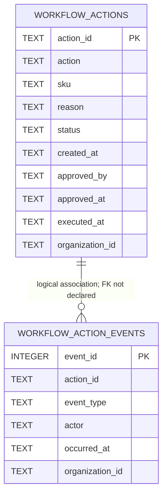

# API and Data Model

**Evidence source:** [`src/api/main.py`](../../src/api/main.py), [`src/workflows/actions.py`](../../src/workflows/actions.py), [`src/workflows/authorization.py`](../../src/workflows/authorization.py), and API/workflow tests.

## Contents

- [API conventions](#api-conventions)
- [Routes](#routes)
- [Authentication and authorization](#authentication-and-authorization)
- [Data validation and errors](#data-validation-and-errors)
- [SQLite configuration and schema](#sqlite-configuration-and-schema)
- [Transaction and integrity behavior](#transaction-and-integrity-behavior)
- [Limitations](#limitations)

## API conventions

The API is a FastAPI application named “AI Business Operations API”, version `0.1.0`. The module exposes `app`. Successful responses are JSON dictionaries. FastAPI’s standard validation/documentation behavior is available through its defaults; no custom API versioning or pagination layer was found.

## Routes

All routes except `GET /health` require the bearer-auth dependency.

| Method and path | Request | Success response / effects | Important errors |
|---|---|---|---|
| `GET /health` | None | `{"status":"ok"}`; no business data | — |
| `POST /workflow/replenishment` | JSON `{"sku": "...", "reason": "..."}`; SKU 1–100 chars, reason 1–2000 | `201`; `success`, `action`, message; persists proposal and creation event | `401`, `403`, `422` |
| `GET /workflow/actions/{action_id}` | Path ID | Action row visible to actor’s organization | `401`, `403`, `404` |
| `GET /workflow/actions/{action_id}/events` | Path ID | `{"action_id": "...", "events": [...]}` | `401`, `403`, `404` |
| `POST /workflow/actions/{action_id}/approve` | Path ID; no body | `success`, updated action; persists approval and event | `401`, `403`, `404`, `409` |
| `POST /workflow/actions/{action_id}/execute` | Path ID; no body | `success`, updated action, note that no external purchase occurred | `401`, `403`, `404`, `409` |
| `POST /agent/chat` | JSON `{"message":"..."}` or multipart `message` plus all three CSV files or none | `success`, response text, organization ID; agent may call report/investigation/proposal tools | `401`, `413`, `415`, `422`, `500`, `502`, `503` |

### Synthetic request/response shapes

The following are schema examples, not records from a business:

```json
{
  "sku": "SYN-SKU-001",
  "reason": "Synthetic example: stock is at the configured reorder threshold."
}
```

```json
{
  "success": true,
  "action": {
    "action_id": "ACT-EXAMPLE",
    "action": "REPLENISHMENT_REQUEST",
    "sku": "SYN-SKU-001",
    "status": "PENDING_APPROVAL"
  },
  "message": "Proposal created and awaiting human approval."
}
```

The actual generated ID format uses `ACT-` plus eight uppercase hexadecimal characters. The sample above is illustrative only.

For chat, JSON messages are limited to 10,000 characters. Multipart CSV fields must be all present or all absent; each file must have a `.csv` filename when provided, contain data, pass CSV parsing and validation, and be at most 5 MiB. The handler checks Starlette's parsed file size and reads no more than one byte beyond the per-file limit; multipart form resources are closed after processing. The framework parses uploads before the handler's size check and may spool them to temporary storage, so this is not an aggregate request-body or temporary-disk limit. The endpoint does not persist uploaded files as application data.

## Authentication and authorization

FastAPI HTTP Bearer credentials are mapped using the process environment variable `BUSINESS_OPERATIONS_API_TOKENS_JSON`. Its configured JSON maps token strings to server-defined `user_id`, `organization_id`, and role. Tokens are compared with `hmac.compare_digest`; actor identity is not accepted from the agent prompt. Missing/invalid tokens return `401`; missing/invalid server configuration returns `503`.

| Role | Permissions |
|---|---|
| `viewer` | View operations |
| `operator` | View operations; propose action |
| `approver` | View operations; approve; execute |
| `administrator` | All declared permissions, including proposal, approval, execution, and manage-users |

`MANAGE_USERS` is defined but no user-management route was found. An administrator can propose and approve, but approval is rejected with `409` when the same actor created the action. Approval also fails closed when exactly one non-empty creation-event actor cannot be verified; this leaves older pending records without creation provenance pending for manual reconciliation. Execution is not constrained to a third, distinct actor. The API module’s own docstring says the token mapping is a development bootstrap and should be replaced before public exposure.

## Data validation and errors

`validate_business_csv()` normalizes headers by trimming/lowercasing, requires dataset-specific fields, rejects duplicate column names and key IDs, rejects blank required text, converts numeric columns strictly, rejects missing/non-finite/negative values, enforces whole-number quantity/stock fields, and rejects multiple invoices per order. Extra columns are not rejected.

Important API status behavior:

- `401 Unauthorized`: bearer token absent or invalid.
- `403 Forbidden`: authenticated role lacks the required permission.
- `404 Not Found`: action absent or outside the caller’s organization.
- `409 Conflict`: action is not in the required state, the proposer attempts self-approval, or proposer provenance cannot be verified.
- `413 Content Too Large`: an individual multipart file exceeds 5 MiB, based on the parser-reported size or a bounded read of at most 5 MiB plus one byte.
- `415 Unsupported Media Type`: chat content type is neither JSON nor multipart.
- `422 Unprocessable Entity`: malformed chat request, invalid CSV or action fields.
- `500 Internal Server Error`: unexpected agent exception; generic detail, exception logged.
- `502 Bad Gateway`: agent yields no final response text.
- `503 Service Unavailable`: authentication environment configuration missing/invalid.

## SQLite configuration and schema

`WORKFLOW_DB_PATH` overrides the DB path. Otherwise, the default is repository-relative `data/workflow_actions.db`. The path is resolved, its parent directory is created, and SQLite connections use a 10-second timeout. The `.gitignore` excludes local DB files. The existing local DB was opened read-only for schema and aggregate status/provenance counts; no row values or identities were retrieved, and no database writes were made. Some pending legacy actions have no creation event and therefore cannot be approved automatically.

| Table | Columns and constraints | Purpose |
|---|---|---|
| `workflow_actions` | `action_id` text primary key; `action`, `sku`, `reason`, `status`, `created_at` required; status check permits `PENDING_APPROVAL`, `APPROVED`, `EXECUTED`; `approved_by`, `approved_at`, `executed_at` nullable; `organization_id` required, default `default` | Proposal and current lifecycle state |
| `workflow_action_events` | `event_id` integer primary key/autoincrement; `action_id`, `event_type`, `actor`, `occurred_at`, `organization_id` required; event check permits `ACTION_CREATED`, `ACTION_APPROVED`, `ACTION_EXECUTED` | Lifecycle history |

Indexes exist on `(organization_id, status)` and `(organization_id, action_id, event_id)`. The code adds `organization_id` columns to legacy tables where absent. Although `PRAGMA foreign_keys = ON` is enabled, no foreign-key constraint is declared in the table definitions.



Business CSV data is source input, not persisted in these tables. Workflow rows contain the proposed action and organization; audit rows contain event metadata. The diagram’s relationship is logical only; no DB-level FK is present.

## Transaction and integrity behavior

Workflow create/approve/execute and the corresponding event insert share one SQLite connection context; successful operations commit together. Approval verifies the unique creation-event actor within the same connection context before its conditional state update, and only an actor other than the proposer can approve. An action without exactly one non-empty creation actor remains pending and cannot be approved. State changes use conditional SQL updates to prevent a transition from an unexpected state. SQL values are parameterized. Reads are organization-scoped. SQLite is not wrapped in an external transaction coordinator, and no explicit cross-process locking, backup, retention, migration versioning, or restore process is implemented.

The event log has no API mutation route, but it is not tamper-proof or database-enforced append-only. There is no rejection/cancellation state and no idempotency key for an external operation; current execution is simulation only.

## Limitations

- The database stores workflow records only, not canonical orders, invoices, stock, payments, or suppliers.
- The default file-backed SQLite location is suitable for local development, not proof of a multi-instance deployment design.
- `InMemorySessionService` stores chat history in process memory; it is unrelated to SQLite workflow persistence.
- There is no documented token rotation process or identity-provider implementation.
- There are no external business integrations or real purchase-order semantics in this API.
