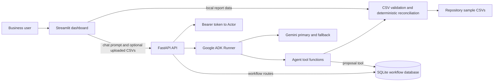

# Architecture and Data Flow

**Evidence scope:** current repository source and tests as of 2026-10-15. See [system overview](SYSTEM_OVERVIEW.md) and [API/data model](API_AND_DATA_MODEL.md).

## Contents

- [Component responsibility matrix](#component-responsibility-matrix)
- [Module dependency map](#module-dependency-map)
- [Startup and request flows](#startup-and-request-flows)
- [Workflow lifecycle](#workflow-lifecycle)
- [Errors and external dependencies](#errors-and-external-dependencies)
- [Current architectural constraints](#current-architectural-constraints)
- [Future architecture recommendations](#future-architecture-recommendations)

## Component responsibility matrix

| Component | Code location | Inputs | Outputs / side effects | Key constraints |
|---|---|---|---|---|
| Streamlit UI | [`dashboard.py`](../../dashboard.py) | Optional three CSV files, chat prompt, process environment | Report tables; HTTP request to API | Uploads held in Streamlit session memory; no approval UI. |
| API | [`src/api/main.py`](../../src/api/main.py) | JSON, multipart form, bearer credentials | JSON responses; workflow DB changes; ADK calls | Local bearer token registry; 5 MiB per-file CSV limit; no aggregate body limit. |
| Actor authorization | [`src/workflows/authorization.py`](../../src/workflows/authorization.py) | `Actor`, permission | Allow or raises `AuthorizationError` | Four static roles; no user-management endpoint. |
| Agent | [`src/agents/business_operations_agent.py`](../../src/agents/business_operations_agent.py) | User text plus tool outputs | Natural-language explanation; may propose workflow action | Model behavior is probabilistic; prompt says tools are authoritative for current facts. |
| Reconciliation | [`src/reconciliation/engine.py`](../../src/reconciliation/engine.py), `report.py`, `business_rules.py`, `uploads.py` | Pandas data frames or sample CSVs | Structured exception report / entity details | Rules cover only the listed columns and one invoice per order. |
| Request context | [`src/agents/business_data_context.py`](../../src/agents/business_data_context.py), `request_context.py` | Validated frames and trusted actor | ContextVar values for current async request | Values are reset in `finally` after agent run. |
| Workflow state | [`src/workflows/actions.py`](../../src/workflows/actions.py) | Authorized action requests | SQLite action rows and event rows | Execution is simulated; no supplier system is called. |
| Model fallback | [`src/agents/model_fallback.py`](../../src/agents/model_fallback.py) | ADK LLM request | Primary or fallback Gemini output | Fallback is not attempted after the primary has yielded output. |

## Architecture diagram



## Module dependency map

```text
dashboard.py
  ├─ src.reconciliation.uploads.validate_business_csv
  ├─ src.reconciliation.report.build_operations_report
  └─ HTTP POST /agent/chat → src.api.main

src.api.main
  ├─ src.workflows.authorization (Actor, Role, AuthorizationError)
  ├─ src.workflows.actions (SQLite workflows)
  ├─ src.reconciliation.uploads (multipart CSV validation)
  ├─ src.agents.business_operations_agent.root_agent
  ├─ src.agents.request_context (trusted actor ContextVar)
  ├─ src.agents.business_data_context (dataset ContextVar)
  └─ Google ADK Runner + InMemorySessionService

src.agents.business_operations_agent
  ├─ src.reconciliation.engine + report (deterministic tools)
  ├─ src.workflows.actions (proposal tool)
  ├─ src.agents.request_context + business_data_context
  └─ src.agents.model_fallback → Google ADK Gemini models

src.reconciliation.report
  ├─ src.reconciliation.engine
  └─ src.reconciliation.business_rules
```

## Startup and request flows

### Process startup

1. `uvicorn` imports `src.api.main:app` (the application module exposes the FastAPI object as `app`).
2. Import-time initialization creates the ADK `InMemorySessionService` and `Runner`, connecting the configured `root_agent` to the service.
3. Workflow SQLite schema is initialized lazily when a workflow operation calls `_connect()`; importing the API does not itself read existing database records.
4. Streamlit runs `dashboard.py` separately. It generates its report on rerun from all three uploads or from repository demonstration CSV files.

### Agent chat / report path

```mermaid
sequenceDiagram
    actor User
    participant UI as Streamlit dashboard
    participant API as FastAPI /agent/chat
    participant Auth as Token/role resolver
    participant ADK as ADK Runner
    participant Agent as Business operations agent
    participant Tool as Deterministic tool
    participant Data as CSV/report modules
    participant Model as Gemini

    User->>UI: Submit prompt (optional three CSVs)
    UI->>API: POST /agent/chat with bearer token
    API->>Auth: Resolve server-configured Actor
    Auth-->>API: Actor or HTTP error
    API->>API: Parse JSON or multipart; validate all uploaded CSVs
    API->>ADK: Create/reuse in-memory session and run prompt
    ADK->>Agent: Invoke configured agent
    Agent->>Tool: Select report or entity investigation tool
    Tool->>Data: Use request data, or sample CSVs if no upload
    Data-->>Tool: Deterministic result
    Tool-->>Agent: Structured verified result
    Agent->>Model: Generate answer from prompt and tool result
    Model-->>Agent: Text response
    Agent-->>ADK: Final event
    ADK-->>API: Final response text
    API-->>UI: JSON success/response/organization_id
    UI-->>User: Display conversation
```

The function tools are deterministic code; selection and natural-language presentation are model-mediated. The code contains instructions to investigate specific entities and not make unsupported claims, but no code can prove that every model response obeys those instructions.

### Workflow action path

```mermaid
sequenceDiagram
    actor Operator
    actor Approver
    participant API as FastAPI workflow routes
    participant Auth as Actor/permission checks
    participant DB as SQLite actions + events

    Operator->>API: POST /workflow/replenishment
    API->>Auth: Require PROPOSE_ACTION
    API->>DB: Insert PENDING_APPROVAL + ACTION_CREATED
    DB-->>API: Action ID and state
    API-->>Operator: 201 proposal response
    Approver->>API: POST /workflow/actions/{id}/approve
    API->>Auth: Require APPROVE_ACTION and organization visibility
    API->>DB: Verify one ACTION_CREATED actor differs from approver
    API->>DB: Conditional PENDING_APPROVAL → APPROVED + event
    DB-->>API: Updated action
    API-->>Approver: Approved action
    Approver->>API: POST /workflow/actions/{id}/execute
    API->>Auth: Require EXECUTE_ACTION and organization visibility
    API->>DB: Conditional APPROVED → EXECUTED + event
    DB-->>API: Updated local action record
    API-->>Approver: Execution is simulated; no external purchase
```

## Workflow lifecycle

The permitted persisted states are `PENDING_APPROVAL`, `APPROVED`, and `EXECUTED`. Creation writes the first state; approval uses an update conditioned on `PENDING_APPROVAL`; simulated execution requires `APPROVED`. A repeat transition does not create another event and returns a conflict at the API boundary. Unknown or cross-organization actions are not exposed as accessible records.

There is no persisted `REJECTED`, `CANCELLED`, or `FAILED` state, no rejection route, and no retry/compensation workflow. Approval is blocked if the proposer and approver are the same authenticated user, or if the action does not have exactly one non-empty `ACTION_CREATED` actor to establish provenance. A denied transition leaves the action unchanged and emits no success event. Pending legacy actions without creation provenance require manual reconciliation. Execution may be performed by the proposer or approver after a separate actor approves; a third-person execution requirement is not enforced. `action_id` is generated as `ACT-` plus eight uppercase hexadecimal characters. The trusted actor's `user_id` is stored as event actor; organization ID scopes both tables.

## Errors and external dependencies

- CSV parsing/validation errors become client errors; unsupported chat content types are rejected.
- Authorization errors become `403`; missing/invalid tokens return `401`; unset/invalid token configuration returns `503`.
- Workflow invalid transitions become `409`; inaccessible records are hidden as `404` at API lookup.
- Agent failures are logged server-side and returned as a generic `500`; a missing final response becomes `502`.
- The API logs unexpected agent exceptions with a stack trace. No structured telemetry or correlation-ID framework was found.
- External runtime dependency: Gemini access through Google ADK/GenAI. No accounting, supplier, inventory, payment, identity provider, or durable conversation service integration was found.

## Current architectural constraints

- In-memory ADK sessions are process-local and disappear at restart.
- SQLite is a single local file by default; no managed database or deployment topology is included.
- CSV uploads are per-request inputs and are not saved by the dashboard upload flow.
- The API uses parser-reported file sizes and bounded reads at 5 MiB per CSV, and closes multipart form resources; the framework parses the body first and may spool parts to temporary storage. No aggregate request-body, field-count, or temporary-storage limit is configured by this API handler.
- The report and agent consume the same validated uploaded datasets only when all three files are supplied.
- The database contains workflow proposals and audit events, not canonical order, invoice, or inventory records.
- The audit-event table has no declared foreign-key constraint and no database-level append-only enforcement.
- Role authorization allows `administrator` all permissions, including proposal, approval, and execution, but the workflow prevents an administrator from approving their own proposal.

## Future architecture recommendations

These are recommendations, not current features:

1. Replace the development bearer-token mapping with a supported identity provider and managed secret handling.
2. Deploy API and UI behind TLS, establish aggregate request-body and temporary-storage limits before multipart parsing, and add access/rate monitoring.
3. Define separation-of-duties policy, rejection/cancellation, idempotency, and durable error states before connecting real side-effecting systems.
4. Use a supported managed relational database with migration/version control, backups, and defined retention.
5. Add prompt-injection handling for untrusted uploaded text and maintain an evaluation set for model/tool behavior.
6. Introduce explicit external-adapter boundaries and reconciliation against authoritative accounting/order systems only when those integrations are implemented.
