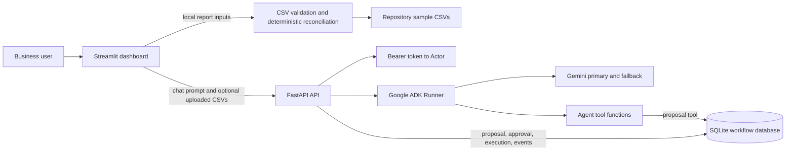

# AI Business Operations Agent — System Overview

**Audit date:** 2026-10-15

**Owner/brand in the application:** Slimes.Hustlers AI Solutions

**Scope:** Current working tree at audit time; this is a static/code-based review plus the isolated pytest suite, not a production assessment.

## Repository snapshot

The checkout was on branch `main`, one commit ahead of `origin/main`, at `4f3386a3cf0e781b3c0fa77b604715c61c072bd6` (`Add Gemini model fallback for business operations agent`, 2026-10-13). Several application, test, and instruction files were already modified or untracked before this audit; they were preserved. The documentation findings describe that working tree, not only the last commit.

## Contents

- [Executive summary](#executive-summary)
- [Problem and solution](#problem-and-solution)
- [Verified capabilities](#verified-capabilities)
- [Architecture](#architecture)
- [Technology and components](#technology-and-components)
- [Business value and maturity](#business-value-and-maturity)
- [Limitations and non-functional considerations](#limitations-and-non-functional-considerations)
- [Related audit documents](#related-audit-documents)

## Executive summary

The repository contains a Python business-operations prototype that combines deterministic CSV reconciliation, inventory threshold checks, an authenticated FastAPI service, a Streamlit reporting/chat dashboard, and a Google ADK agent backed by Gemini. The application can report on sample files or on a complete set of validated CSV uploads. The LLM is instructed to explain verified tool results rather than invent business facts. Separate workflow endpoints persist replenishment proposals and their approval/execution transitions in SQLite.

The workflow's `EXECUTED` state means the local action record was marked executed. The API explicitly states that execution is simulated and does **not** place a supplier purchase. No integration with accounting, ERP, inventory, payment, or supplier systems was found in the inspected source.

The original test baseline passed **58 tests**; after targeted remediation, the final isolated test suite passed **73 tests** with **6 dependency/framework warnings**. This supports the tested code paths, not live model behavior, deployment readiness, or a customer production rollout. Pre-existing working-tree changes were preserved; only changes directly related to verified remediation and its tests were made. See [audit findings and roadmap](AUDIT_FINDINGS_AND_ROADMAP.md) for remaining priorities.

## Problem and solution

The implemented use case is to bring order, invoice, and inventory CSV records into one deterministic report, identify selected exceptions, and let a business user ask an AI agent to explain an exception or create a controlled replenishment proposal. The prototype is a local, file-oriented workflow rather than a continuously synchronized business system.

The reconciliation engine computes expected order amount as `quantity × unit_price`, compares it with the matched invoice amount, identifies unmatched invoices and low-stock rows, and applies fixed priorities/actions. The agent can call report and item-investigation tools. Workflow proposals are stored separately from the source business CSVs.

## Verified capabilities

| Capability | Evidence-based status |
|---|---|
| Operations report from repository sample CSVs | Implemented; the dashboard labels it demonstration data. `src/reconciliation/engine.py`, `report.py`, `dashboard.py`. |
| Full three-file CSV upload and validation | Implemented in the current working tree; API and dashboard require orders, invoices, and inventory together. `src/reconciliation/uploads.py`, `src/api/main.py`. |
| Order/invoice matching, amount mismatch, missing invoice, orphan invoice | Implemented deterministically. `src/reconciliation/engine.py`. |
| Inventory threshold exceptions and priority labels | Implemented; equality-boundary behavior differs between report and item lookup. See [findings](TESTING_AND_SECURITY_AUDIT.md#findings). |
| AI-assisted report and entity investigation | Implemented through Google ADK tools and Gemini model configuration. No live model call was made during the audit. |
| Authenticated roles and organization-scoped workflow endpoints | Implemented with a development bearer-token registry and role checks. |
| Proposal, approval, simulated execution, and event recording | Implemented in SQLite; no external purchase is made. |
| Customer-facing dashboard | Streamlit dashboard exists in the current working tree; it displays reports and an agent chat, not workflow approvals. |
| External business-system integration | Not found in the inspected repository. |

## Architecture

This is the code-defined topology, not a deployment diagram. The local database defaults to `data/workflow_actions.db`; agent conversation sessions use in-memory ADK storage.

## Technology and components

The project pins packages in [`requirements.txt`](../../requirements.txt). [`pyproject.toml`](../../pyproject.toml) currently contains pytest configuration rather than project metadata, scripts, or a declared Python version.

| Area | Implementation and responsibility |
|---|---|
| UI | [`dashboard.py`](../../dashboard.py) — Streamlit upload/report/chat experience. Chat posts to `/agent/chat`. |
| API | [`src/api/main.py`](../../src/api/main.py) — FastAPI health, chat, and workflow routes; token-to-actor resolution; request parsing and role checks. |
| Agent | [`src/agents/business_operations_agent.py`](../../src/agents/business_operations_agent.py) — ADK `Agent`, system instruction, deterministic function tools, Gemini fallback configuration. |
| Model fallback | [`src/agents/model_fallback.py`](../../src/agents/model_fallback.py) — tries configured primary model, then fallback only if primary fails before producing output. |
| Request context | [`src/agents/request_context.py`](../../src/agents/request_context.py), [`business_data_context.py`](../../src/agents/business_data_context.py) — request-local actor and optional uploaded datasets, reset after agent execution. |
| Reconciliation | [`src/reconciliation/`](../../src/reconciliation) — CSV input validation, deterministic comparison, report shaping, and business priorities. |
| Workflow persistence | [`src/workflows/actions.py`](../../src/workflows/actions.py), [`authorization.py`](../../src/workflows/authorization.py) — SQLite action state, event history, role permissions. |
| Tests | [`tests/`](../../tests) — pytest unit/API tests; workflow database is redirected to a `tmp_path` per test by `conftest.py`. |

## Business value and maturity

The prototype demonstrates practical AI-workflow engineering concepts: deterministic data checks, an LLM explanation layer, request-scoped business inputs, role-based controls, persisted proposals, and auditable state transitions. The same patterns could inform future QuickBooks, ERP, order-management, or HR integrations, but no such integration is present.

**Maturity assessment:** suitable for a local demonstration with configured model credentials; potentially useful for a controlled, non-production pilot only after the readiness gaps in the [roadmap](AUDIT_FINDINGS_AND_ROADMAP.md) are resolved. It is not evidenced as an internally deployed or production system.

## Limitations and non-functional considerations

- The business data interface is CSV-oriented and does not synchronize records.
- Data validation assumes at most one invoice per order; no payment transaction source exists.
- Several business rules are simplified (including the one-cent amount tolerance and inventory reorder comparison).
- The in-memory ADK session service loses conversations when the process restarts.
- Workflow state is stored in local SQLite; backup, retention, hosted availability, and operational monitoring are not implemented in the inspected code.
- The token registry is a development bootstrap, not an identity-provider integration.
- Agent instructions are guardrails, not a deterministic guarantee against model errors or prompt injection.
- No README, `.github` CI workflow, deployment manifest, or setup guide was found in the tracked repository listing.

## Related audit documents

- [Architecture and data flow](ARCHITECTURE_AND_DATA_FLOW.md)
- [Business workflows](BUSINESS_WORKFLOWS.md)
- [API and data model](API_AND_DATA_MODEL.md)
- [Testing and security audit](TESTING_AND_SECURITY_AUDIT.md)
- [Developer and operator guide](DEVELOPER_AND_OPERATOR_GUIDE.md)
- [Portfolio technical case study](PORTFOLIO_TECHNICAL_CASE_STUDY.md)
- [Audit findings and roadmap](AUDIT_FINDINGS_AND_ROADMAP.md)
